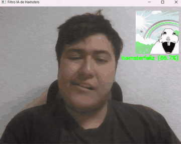

# Hamster Expression Filter

Real-time webcam filter that **recognizes your facial expression** and shows the matching hamster meme. It uses
**MediaPipe Face Mesh** to extract facial landmarks and a **dense neural network** (Keras) to classify the expression.

Final Project for the *Selected Topics in AI* course (8th semester, Computer Systems Engineering, Instituto Tecnológico de
Mérida, Mexico).



[Watch the full video (MP4)](demo/hamster-expression-filter-demo.mp4)

## How it works

```
webcam → MediaPipe Face Mesh (478 x, y, z points) → normalization → neural network → frame averaging → hamster
```

1. **Data:** 300 webcam frames are recorded per expression; each frame is stored as a row of raw facial landmarks
   (`src/record_dataset.py`).
2. **Normalization** (`src/features.py`): each face is centered, scaled by the distance between the eyes and rotated so
   the eyes are level. The model sees the shape of the face, not where it is or how close it is to the camera.
3. **Model** (`src/train.py`): `Normalization → 128 → Dropout(0.3) → 64 → Dropout(0.3) → softmax`, trained with Adam
   and `EarlyStopping`, which keeps the weights of the best epoch.
4. **Demo** (`src/filter_webcam.py`): averages the predictions of the last 8 frames so the hamster doesn't flicker, and
   shows nothing when confidence is below 60%.

Classes: `hamsteraura`, `hamsterfeliz` (happy), `hamsterlibroabierto` (open book), `hamsterlupa` (magnifying glass),
`hamstermrbean`, `hamsterpaleta` (lollipop), `hamsterenojado` (angry), `hamsterasombrado` (surprised),
`hamsternobrain` and `neutral` (resting face, no hamster). The `neutral` class keeps a blank face from being assigned
to the most similar expression.

## Results

10 classes × 300 frames = 3,000 samples. Validation is **temporal**: the last 60 frames of each recording (20%) are
held out from training. Consecutive frames are nearly identical, so a random split leaks near-copies of the training
data into validation; with it, any model scores ~99%, which says nothing.

**Neural network (the one used in the demo):** 90.0% validation accuracy.

| Change from the original notebook (same temporal split) | Accuracy |
|---|---|
| Original notebook: raw landmarks, no input scaling | 0.66 |
| + input standardization (`Normalization` layer) | 0.83 |
| + normalized landmarks (position, scale, rotation) and `EarlyStopping` | **0.90** |

**Comparison with other classifiers** (`src/compare_models.py`, same split):

| Model | Raw landmarks | Normalized landmarks |
|---|---|---|
| Logistic regression | 0.795 | 0.922 |
| SVM (RBF, C=100) | 0.927 | 0.923 |
| PCA(50) + SVM | 0.925 | 0.923 |
| Random Forest | 0.743 | 0.885 |
| KNN (k=5) | 0.782 | 0.838 |
| scikit-learn MLP | 0.740 | 0.860 |

Normalization greatly improves almost every model (logistic regression: +13 points). The RBF SVM is already robust on
raw data. With PCA, 50 components (out of 1,434) are enough for the same result.

| Training curves | Confusion matrix |
|---|---|
|  |  |

**Where it fails:** almost all errors are between `neutral`, `hamsteraura` and `hamsterenojado`, three serious-looking
expressions that are very similar. The other 7 classes reach F1 ≥ 0.99. Improving those three is a data problem (more
distinct expressions), not a model problem: every classifier hits the same ~92% ceiling.

**Limitations:** the data comes from a single person and a few recording sessions. Generalizing would require recording
more people and validating on people not seen during training.

## Project structure

```
hamster-expression-filter/
├── src/
│   ├── features.py         # landmark normalization (shared by everything)
│   ├── data.py             # CSV loading and temporal split
│   ├── record_dataset.py   # records an expression from the webcam into a CSV
│   ├── train.py            # trains the network; saves curves, confusion matrix and metrics
│   ├── compare_models.py   # compares scikit-learn classifiers
│   └── filter_webcam.py    # live webcam demo
├── models/
│   ├── modelo_hamsters.keras
│   └── clases.npy
├── results/                # curves, confusion matrix, metrics.json, model_comparison.csv
├── demo/                   # demo GIF and video
└── requirements.txt
```

## Usage

Requires **Python 3.11 or 3.12**. MediaPipe 0.10.21 has no build for Python 3.13, and newer MediaPipe releases dropped
the `mp.solutions` API this project uses. Use a virtual environment so these TensorFlow and MediaPipe versions don't
clash with other projects.

```bash
git clone https://github.com/DimoltoSs/hamster-expression-filter.git
cd hamster-expression-filter
python -m venv .venv
.venv\Scripts\activate        # Linux/macOS: source .venv/bin/activate (the prompt should show "(.venv)")
pip install -r requirements.txt

python src/filter_webcam.py
```

Press `q` in the window to quit. Options: `--camera 1`, `--suavizado 10` (number of frames averaged) and
`--umbral 0.7` (minimum confidence to show a hamster).

### Hamster images

The images are **not included** in the repository (they are third-party memes). Create a `figuras/` folder and put one
image per class there, using the file names listed in the `FIGURAS` dictionary in `src/filter_webcam.py`. If an image
is missing, the demo still works and shows only the class name and probability.

### Record your own expressions and retrain

```bash
python src/record_dataset.py --label hamsterfeliz --frames 300    # once per expression
python src/train.py                                               # trains the demo network
python src/compare_models.py                                      # optional: compares other models
```

The CSV files store raw landmarks; normalization is applied at training time and in the demo.

## Tech stack

Python · TensorFlow/Keras · MediaPipe Face Mesh · OpenCV · scikit-learn · pandas

## Credits and licenses

- **MediaPipe** (Google), Apache 2.0 license.
- The hamster and meme images belong to their respective authors. They appear in the demo but are not included as files
  in this repository.
- The training data consists of the author's own facial landmarks and is not published.

## Author

Angel Josué López Castilla · [@DimoltoSs](https://github.com/DimoltoSs)
