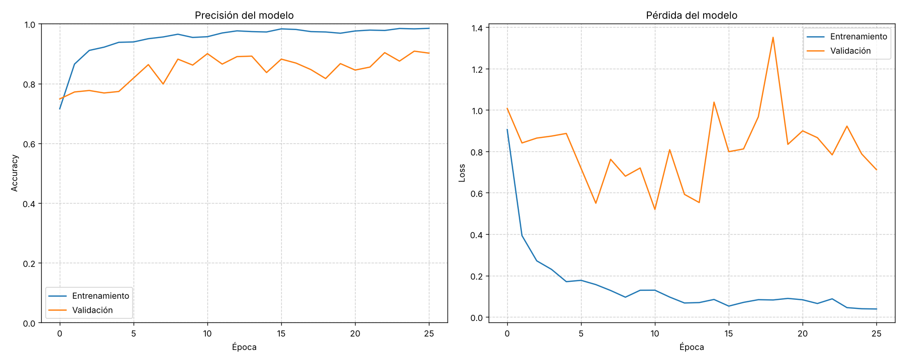
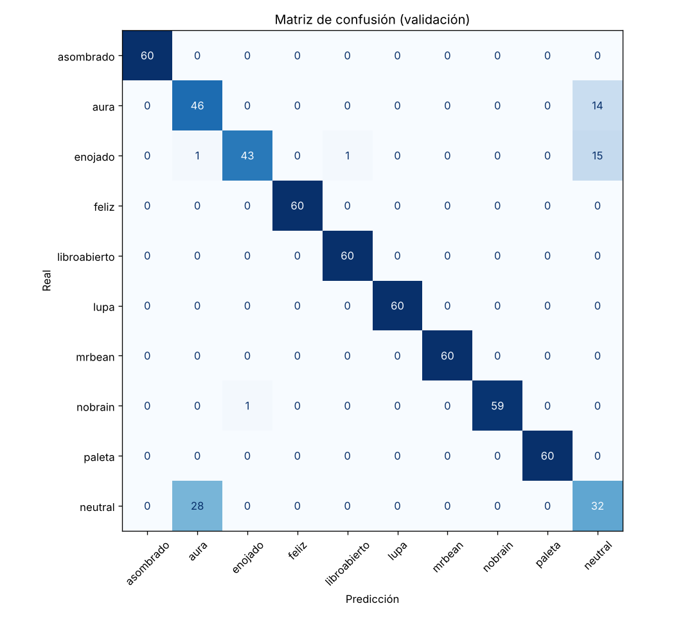

# Filtro de hamsters por expresión facial

Aplicación que reconoce **tu expresión facial en tiempo real** con la cámara y muestra el hamster que le corresponde.
Se usa **MediaPipe Face Mesh** para obtener los puntos del rostro y una **red neuronal densa** (Keras) para
clasificar la expresión.

Proyecto de la materia *Tópicos Selectos de IA* (8.º semestre, Ingeniería en Sistemas Computacionales, Instituto
Tecnológico de Mérida).


[Ver el video completo (MP4)](demo/hamster-expression-filter-demo.mp4)

## Cómo funciona

```
cámara → MediaPipe Face Mesh (478 puntos x, y, z) → normalización → red neuronal → promedio de cuadros → hamster
```

1. **Datos:** para cada expresión se graban 300 cuadros con la cámara; cada cuadro se guarda como una fila con los
   landmarks faciales crudos (`src/record_dataset.py`).
2. **Normalización** (`src/features.py`): se centra el rostro, se escala por la distancia entre los ojos y se gira para
   que los ojos queden horizontales. Así el modelo ve la forma de la cara y no dónde está ni qué tan cerca.
3. **Modelo** (`src/train.py`): `Normalization → 128 → Dropout(0.3) → 64 → Dropout(0.3) → softmax`, entrenado con Adam
   y `EarlyStopping`, que conserva los pesos de la mejor época.
4. **Demo** (`src/filter_webcam.py`): promedia la predicción de los últimos 8 cuadros para que el hamster no parpadee y
   no muestra nada si la confianza es menor a 60 %.

Clases: `hamsteraura`, `hamsterfeliz`, `hamsterlibroabierto`, `hamsterlupa`, `hamstermrbean`, `hamsterpaleta`,
`hamsterenojado`, `hamsterasombrado`, `hamsternobrain` y `neutral` (cara en reposo, no muestra hamster). La clase
`neutral` evita que una cara sin expresión se asigne a la clase más parecida.

## Resultados

10 clases × 300 cuadros = 3000 muestras. La validación es **temporal**: los últimos 60 cuadros de cada grabación
(20 %) no se usan para entrenar. Los cuadros seguidos son casi idénticos, y una división aleatoria mete "copias" del
entrenamiento en la validación; con ella cualquier modelo marca ~99 %, una cifra que no dice nada.

**Red neuronal (modelo de la demo):** 90.0 % de accuracy en validación.

| Cambio respecto al notebook original (misma división temporal) | Accuracy |
|---|---|
| Notebook original: landmarks crudos, sin estandarizar | 0.66 |
| + estandarización de entradas (capa `Normalization`) | 0.83 |
| + landmarks normalizados (posición, escala, rotación) y `EarlyStopping` | **0.90** |

**Comparación con otros clasificadores** (`src/compare_models.py`, misma división):

| Modelo | Landmarks crudos | Landmarks normalizados |
|---|---|---|
| Regresión logística | 0.795 | 0.922 |
| SVM (RBF, C=100) | 0.927 | 0.923 |
| PCA(50) + SVM | 0.925 | 0.923 |
| Random Forest | 0.743 | 0.885 |
| KNN (k=5) | 0.782 | 0.838 |
| MLP de scikit-learn | 0.740 | 0.860 |

La normalización mejora mucho a casi todos los modelos (regresión logística: +13 puntos). El SVM con RBF ya es robusto
con los datos crudos. Con PCA, 50 componentes (de 1434) bastan para el mismo resultado.

| Curvas de entrenamiento | Matriz de confusión |
|---|---|
|  |  |

**Dónde falla:** casi todos los errores están entre `neutral`, `hamsteraura` y `hamsterenojado`, que son expresiones
serias muy parecidas entre sí. Las otras 7 clases tienen F1 ≥ 0.99. Mejorar estas tres es un tema de datos (expresiones
más marcadas), no del modelo: todos los clasificadores tocan el mismo techo de ~92 %.

**Limitaciones:** los datos son de una sola persona y de pocas sesiones de grabación. Para generalizar haría falta
grabar a más personas y validar con personas que no estén en el entrenamiento.

## Estructura

```
hamster-expression-filter/
├── src/
│   ├── features.py         # normalización de landmarks (compartida por todo)
│   ├── data.py             # carga de CSV y división temporal
│   ├── record_dataset.py   # graba una expresión con la cámara y genera el CSV
│   ├── train.py            # entrena la red y guarda curvas, matriz de confusión y métricas
│   ├── compare_models.py   # compara clasificadores de scikit-learn
│   └── filter_webcam.py    # demo en vivo con la cámara
├── models/
│   ├── modelo_hamsters.keras
│   └── clases.npy
├── results/                # curvas, matriz de confusión, metrics.json, model_comparison.csv
├── demo/                   # GIF y video de la demo
└── requirements.txt
```

## Cómo usarlo

Requiere **Python 3.11 o 3.12**. MediaPipe 0.10.21 no tiene versión para Python 3.13, y las versiones más nuevas de
MediaPipe ya no incluyen la API `mp.solutions` que usa este proyecto. Usa un entorno virtual para no mezclar las
versiones de TensorFlow y MediaPipe con las de otros proyectos.

```bash
git clone https://github.com/DimoltoSs/hamster-expression-filter.git
cd hamster-expression-filter
python -m venv .venv
.venv\Scripts\activate        # en Linux/macOS: source .venv/bin/activate (el prompt debe mostrar "(.venv)")
pip install -r requirements.txt

python src/filter_webcam.py
```

Presiona `q` en la ventana para salir. Opciones: `--camera 1`, `--suavizado 10` (cuadros promediados) y `--umbral 0.7`
(confianza mínima para mostrar un hamster).

### Imágenes de los hamsters

Las imágenes **no se incluyen** en el repositorio (son imágenes de terceros). Crea una carpeta `figuras/` y pon ahí un
archivo por clase con los nombres que aparecen en el diccionario `FIGURAS` de `src/filter_webcam.py`. Si falta alguna,
la demo funciona igual y solo muestra el nombre de la clase con su probabilidad.

### Grabar tus propias expresiones y reentrenar

```bash
python src/record_dataset.py --label hamsterfeliz --frames 300    # una vez por expresión
python src/train.py                                               # entrena la red de la demo
python src/compare_models.py                                      # opcional: compara otros modelos
```

Los CSV guardan los landmarks crudos; la normalización se aplica al entrenar y en la demo.

## Tecnologías

Python · TensorFlow/Keras · MediaPipe Face Mesh · OpenCV · scikit-learn · pandas

## Créditos y licencias

- **MediaPipe** (Google), licencia Apache 2.0.
- Las imágenes de hamsters y memes pertenecen a sus respectivos autores. Aparecen en la demo, pero no se incluyen como
  archivos en este repositorio.
- Los datos de entrenamiento son landmarks del rostro del autor; no se publican.

## Autor

Angel Josué López Castilla · [@DimoltoSs](https://github.com/DimoltoSs)
